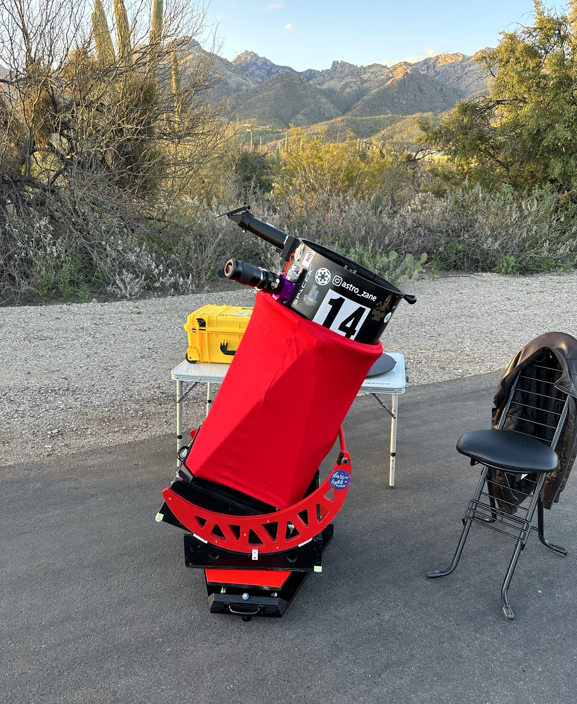
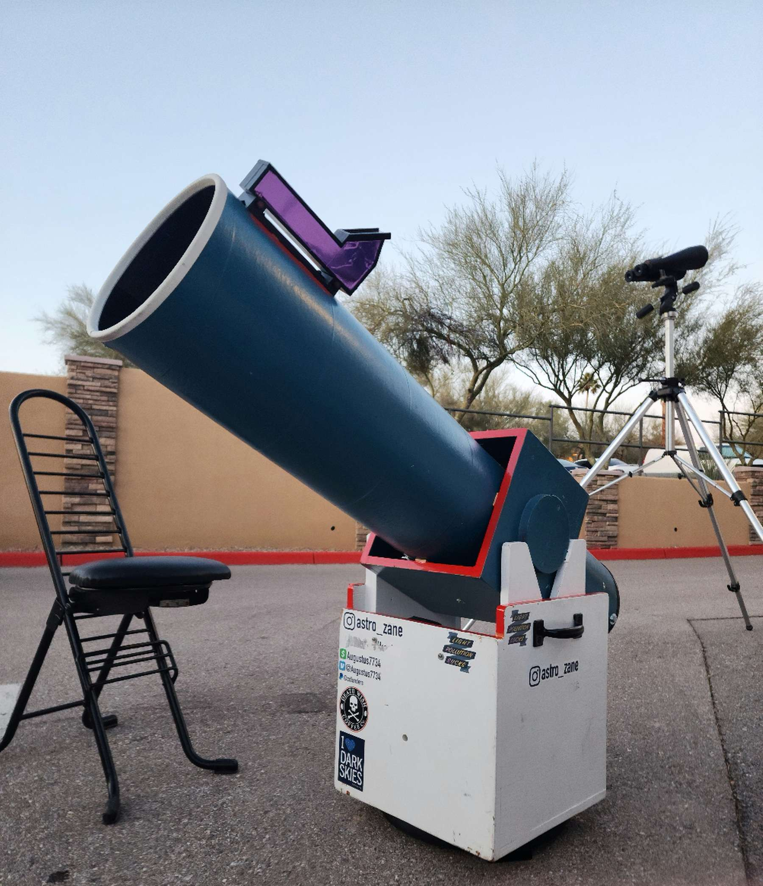
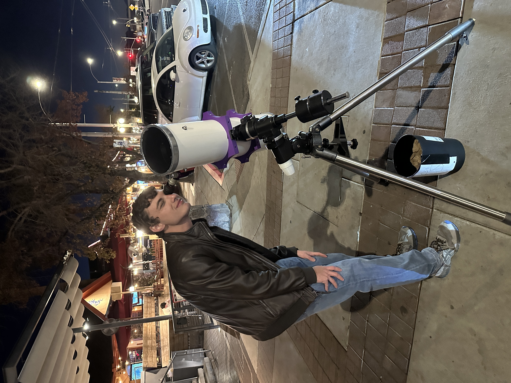
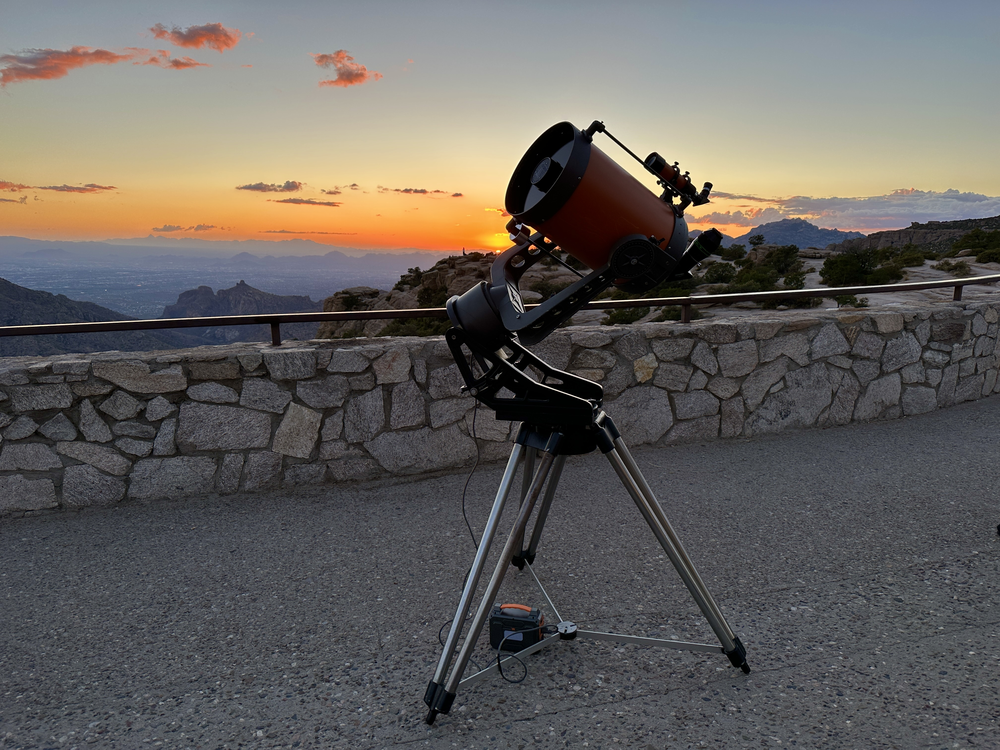
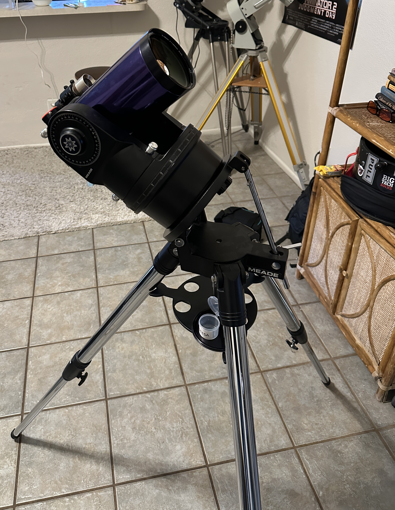
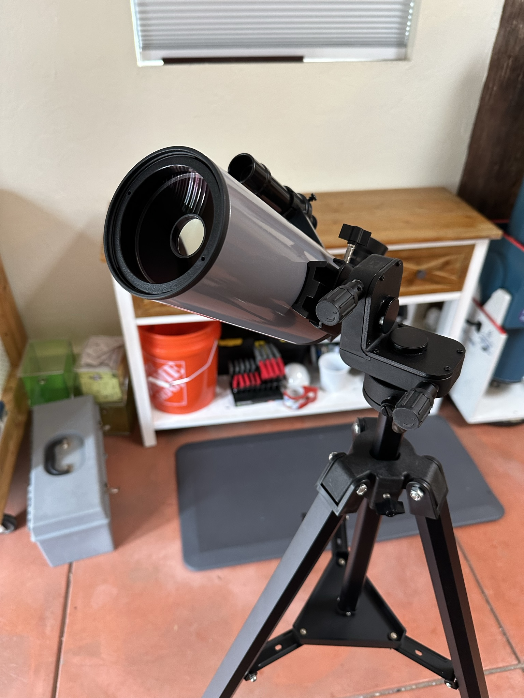

I have owned over 500 telescopes from nearly every brand, including premium ones like Questar, Astro-Physics, Takahashi and Obsession. [The full list is here.](https://docs.google.com/document/d/10u__j-BPwaRjkedsvcIMpclY8nEwKfm2i86mk1ffOos/edit?usp=drive_link)

Currently I mainly observe with my 14.7" f/2.9 Dob, with my 6" f/4.3 for wide-field views. Most of my other telescopes are used for outreach events or quick lunar/planetary views at home.

## Reflectors
### 30" f/4.4 Starsplitter Dobsonian

I share this one with Cole Rees. Starsplitter built it for Gary Myers, and it has a prototype ServoCAT drive. We got it from Ted Forte of the Huachuca Astronomy Club. It lives at Chiricahua Sky Village and stays there, so it is not available for star parties. The focal length is 3353mm, hence the ladder.

The biggest scope I can bring to an event will be my [24" f/4](/projects/24-inch-f4/), once it's finished in 2027.

### [14.7" f/2.9 Dob built by me](https://astrozane.com/projects/147-inch-f29/)

My main telescope, built around a 0.8" thick quartz mirror by Steve Dodds of Nova Optical. It is the one I bring to star parties.

### John Dobson 8" f/6 built circa 1985

Yes, this scope was built by *the* John Dobson himself. I have been told by several people they saw him using it around 1985 in San Francisco. It is extremely sharp optically. It was given to me at Stellafane 2021 and I have used it extensively since.

I added numerous upgrades such as a new ground board, helical 2" focuser, and a better mirror cell. Secondary mirror still is attached to a spider made out of roofing shingles.

### [6" f/4.3 Newtonian built by me](https://astrozane.com/projects/6inch-f4/)

My first homemade optic, made from a mirror blank I got from Dave Groski at Stellafane. The tube is a chopped-down Cave fiberglass tube held together with 3D-printed hardware, and it rides on an SVBONY SV225 mount.

## Schmidt-Cassegrains (SCT)
### Celestron C8 built 1980

TBD

## Maksutov-Cassegrains (MCT)
### SVBONY MK127

A 127mm f/11.8 Maksutov with a separate secondary mirror and a dual-speed focuser, sent to me by SVBONY for review in 2026. It is a really nice telescope. I liked it so much that I sold my Intes MK63. I use it on SVBONY's SV225 mount for quick lunar and planetary views.

### Meade ETX-90RA built 1996

I have had a lot of ETXes; my first, like this one, was an RA unit with a non-working clock drive (thankfully this one lacks the fungus on the corrector which my first had). It has flown across the US with me and I can use it on both its #881 tabletop legs or the #884 heavy duty tripod.

### SarBlue Mak70 2022

I have 2 of these presently, the second was purchased for a video review. Very good lunar, planetary, and double star instruments.

## Smart Telescopes
### ZWO SeeStar S50 Pro

Sent to me by ZWO for review in September 2026, and what I currently image with. I run it in equatorial mode on the wedge and tripod from my 1980 C8. Results are on my [astrophotography page](/astronomy/astrophotography/).
